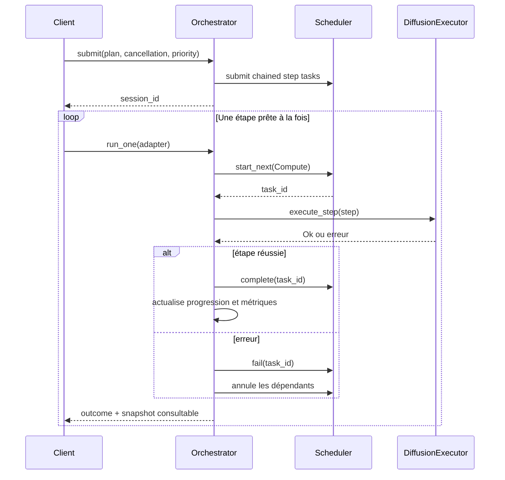

# M9 — Orchestration de diffusion modulaire commune

## Objectif

M9 introduit un cycle d'orchestration commun pour les générations de diffusion par blocs. Le runtime pilote le séquencement et la durée de vie des étapes ; les adaptateurs de modèles exécutent le calcul. Ce jalon ne charge pas de poids, ne construit pas de canvas Gemma et n'implémente pas les opérations propres à Clover.

## API livrée

Le module `claymore_runtime::diffusion` expose :

- `DiffusionPlan` : plan immuable et validé, ordonné par blocs.
- `DiffusionStep` : `PrepareBlock`, `Denoise`, `ValidateBlock`, `CommitBlock`.
- `DiffusionExecutor` : frontière d'exécution implémentée par l'adaptateur de modèle.
- `DiffusionOrchestrator` : admission, dépendances, progression, annulation et propagation des erreurs.
- `DiffusionSessionSnapshot` et `DiffusionMetrics` : état observable sans exposer de tenseurs ni de buffers. Les métriques comptent les sessions, étapes, blocs soumis/committés/en attente, erreurs et annulations ; elles mesurent également le temps passé dans l'exécuteur par phase (préparation, denoising, validation, commit).

## Invariants

1. Chaque bloc suit strictement préparation → une ou plusieurs itérations de débruitage → validation → commit.
2. Les blocs d'un plan sont traités dans l'ordre croissant de leur identifiant.
3. Les étapes d'une session forment une chaîne de dépendances dans une instance dédiée de `Scheduler`. `ScheduledRuntime` expose une façade pour soumettre, exécuter et annuler ces sessions avec la même configuration validée que le scheduler des requêtes/transferts. À priorité égale, les sessions sont FIFO par admission : une chaîne déjà soumise passe avant la chaîne soumise ensuite ; il n'y a pas d'entrelacement ni de garantie d'équité dans M9.
4. Le scheduler dédié ne transporte que des identifiants et des dépendances. Les tenseurs, buffers, événements CUDA et poids restent possédés par les couches d'exécution et de mémoire.
5. L'annulation est coopérative et observée aux frontières d'étapes. Une étape en cours n'est pas déclarée annulée avant le retour de l'exécuteur.
6. Une erreur d'étape échoue la session et le scheduler annule les étapes dépendantes restantes.
7. Le module ne suppose ni moteur autoregressif token-par-token, ni graphe identique entre Gemma et Clover.

## Exécution

Créer un `DiffusionPlan`, soit construire `DiffusionOrchestrator` avec la configuration du scheduler, soit utiliser `ScheduledRuntime::submit_diffusion` / `run_diffusion_one` / `cancel_diffusion` comme façade. L'adaptateur implémente `DiffusionExecutor::execute_step`. Chaque appel à `run_one` exécute au plus une étape prête ; l'appelant peut ainsi rendre la main entre étapes, inspecter `session`/ `metrics`, ou demander une annulation via `cancel`/ `cancel_diffusion`/ `CancellationToken`.

L'orchestrateur est synchrone et reste confiné au thread propriétaire du scheduler. Il n'enqueue pas de kernels et ne prétend pas que le retour d'une mise en file CUDA constitue une fin de calcul : l'adaptateur doit retourner uniquement lorsque la frontière d'étape est sûre.

## Décision d'architecture — scheduler dédié

M9 utilise provisoirement une seconde instance de `Scheduler` configurée à l'identique. La file Compute du `ScheduledRuntime` existant est réservée aux requêtes opaques (`run_one`) et ne peut pas être partagée sans refonte de son contrat d'admission et de dispatch. La séparation évite qu'une étape de diffusion soit interprétée comme une requête sans payload.

Conséquences explicites : pas d'ordonnancement global entre requêtes et diffusion, pas de fenêtre de prefetch partagée, et aucune dépendance `Transfer` ne peut être exprimée dans le graphe de diffusion. La convergence vers un graphe unifié, avec des types de tâches et des payloads explicitement séparés, est suivie comme évolution post-M9.

À priorité égale, les sessions de diffusion sont FIFO : toutes les étapes de la première session admise précèdent celles de la suivante. Une politique round-robin/équité est hors périmètre de cette version.

## Cycle de vie et reprise

Une session suit les états `Queued → Running → Completed | Failed | Cancelled`. Les étapes d'un plan sont pré-admises comme une chaîne de dépendances ; une seule étape prête est exécutée par appel à `run_one`. Un bloc n'est compté comme terminé qu'après le succès de `CommitBlock`.

L'annulation est coopérative : avant une étape, elle empêche son exécution ; si elle est demandée pendant l'appel de l'exécuteur, l'étape réussie est comptabilisée puis l'annulation est observée à la frontière suivante. Une erreur marque la session `Failed` et empêche l'exécution des étapes dépendantes. Les sessions indépendantes restent exécutables.

**Reprise :** M9 ne fournit pas de reprise d'une session terminale ni de rollback des effets déjà réalisés par un adaptateur. Après échec ou annulation, le client peut soumettre une nouvelle session avec un nouveau plan ; la stratégie de reprise, la reconstruction de l'état du modèle et l'idempotence des étapes sont à la charge de l'adaptateur et ne sont pas garanties par le cœur commun.

## Télémétrie CPU

Les compteurs sont déterministes pour une séquence donnée : sessions soumises/terminées/échouées/annulées, étapes commencées/terminées/échouées/annulées, blocs soumis et committés. Une étape en attente annulée par l'annulation d'une session est comptée dans `steps_cancelled` ; les étapes dépendantes annulées à la suite d'un échec sont également comptées. Une étape qui a réussi avant l'observation de l'annulation reste comptée comme terminée. `blocks_pending` est une jauge calculée à la lecture : blocs non committés appartenant aux sessions non terminales ; les blocs d'une session échouée ou annulée ne restent pas « en attente ».

Les durées `*_duration_ns` sont des mesures monotones du seul appel `DiffusionExecutor::execute_step`, classées par phase. `execution_duration_ns` est leur somme. Elles excluent l'attente dans le scheduler et le temps de préparation du scheduler ; elles sont diagnostiques, non déterministes entre exécutions et ne pilotent ni l'ordre des tâches ni les transitions. Aucun compteur VRAM, CUDA ou GPU n'est synthétisé par ce module.

## Diagramme de séquence

## Propriété et synchronisation

- L'orchestrateur possède les snapshots, plans, index de tâches et jetons d'annulation ; le scheduler dédié possède l'état des tâches et leurs dépendances.
- Les poids, tenseurs, buffers, événements CUDA et états spécifiques du modèle restent possédés par l'adaptateur et les services mémoire/exécution.
- Le scheduler et l'orchestrateur restent synchrones et confinés au thread propriétaire ; aucun contrat `Send`/`Sync` ou exécution parallèle n'est promis.
- L'adaptateur ne doit retourner `Ok(())` qu'après que l'étape bornée est sûre à considérer comme terminée, y compris après synchronisation du travail device éventuel.
- Le cœur M9 ne réalise aucune allocation GPU, copie, kernel ou chargement de checkpoint.

## Validation

Les tests unitaires et d'intégration CPU couvrent la validation du plan, l'ordre multi-blocs, le FIFO inter-sessions, l'isolation des échecs, la propagation d'échec, l'annulation avant admission et à une frontière sûre, la progression des blocs après commit, les compteurs et les durées par phase. Les tests CPU sont indépendants de CUDA. La validation matérielle RTX 5090 n'est pas un gate M9, car cette phase ajoute uniquement le contrôle de flux et des contrats CPU.
